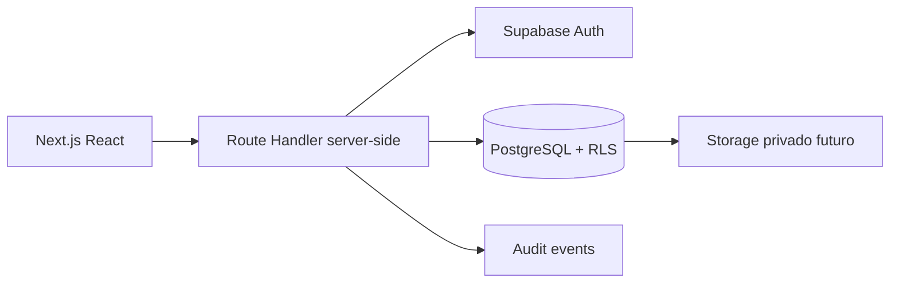
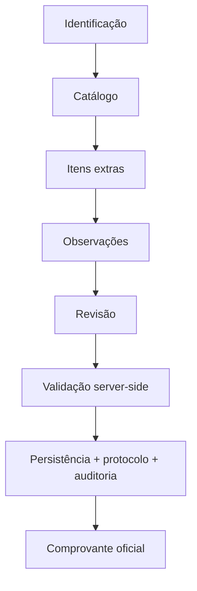

# Home Care Assistant

Fundação de MVP para requisições de insumos em assistência domiciliar. A aplicação é inteiramente em português brasileiro e foi desenhada para Vercel + Supabase, sem serviços pagos obrigatórios.

## Implementado

- Fluxo navegável de requisição com catálogo fictício, itens extras, observações, revisão e comprovante.
- Validação de quantidades no cliente e no servidor com Zod.
- Rota server-side preparada para Supabase Auth, RLS, persistência, protocolo único, idempotência e auditoria.
- Migração PostgreSQL com RLS restritiva e seed explicitamente fictício.
- Resumo para WhatsApp por conversa pré-preenchida e impressão/Salvar como PDF pelo navegador.
- Testes Vitest e configuração Playwright.

O registro oficial fica bloqueado até que Supabase esteja configurado e o solicitante tenha sessão e perfil autorizado. Não há autenticação simulada, dados reais, integração de IA ou automação de WhatsApp Web.

## Executar

```bash
npm install
copy .env.example .env.local
npm run dev
```

Para validar:

```bash
npm run lint
npm run typecheck
npm test
npm run build
```

Configure no `.env.local` apenas `NEXT_PUBLIC_SUPABASE_URL`, `NEXT_PUBLIC_SUPABASE_ANON_KEY` e, para deploy, `NEXT_PUBLIC_APP_URL`. `SUPABASE_SERVICE_ROLE_KEY` não é necessária no MVP e nunca deve ser exposta no cliente.

## Supabase

Com a Supabase CLI instalada, vincule o projeto manualmente e aplique `supabase/migrations`. O seed contém somente uma pessoa assistida fictícia. Crie usuários via Supabase Auth e depois perfis por procedimento administrativo seguro; não habilite cadastro público irrestrito.

Leia [docs/SECURITY.md](docs/SECURITY.md), [docs/DATABASE.md](docs/DATABASE.md) e [docs/DEPLOYMENT.md](docs/DEPLOYMENT.md) antes de qualquer ambiente compartilhado.

## Arquitetura





