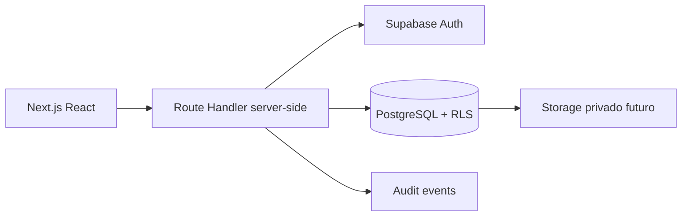
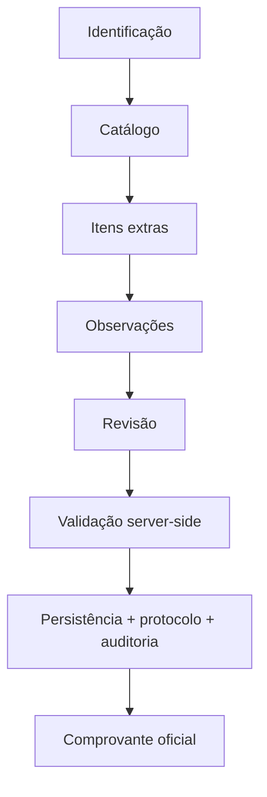

# Home Care Assistant

Fundação de MVP para requisições de insumos em assistência domiciliar. A aplicação é inteiramente em português brasileiro e foi desenhada para Vercel + Supabase, sem serviços pagos obrigatórios.

## Implementado

- Fluxo navegável e responsivo de requisição com catálogo fictício, estoque informado, urgência, itens extras, observações, revisão e comprovante.
- Validação de quantidades no cliente e no servidor com Zod.
- Rota server-side preparada para Supabase Auth, RLS, persistência, protocolo sequencial a partir de 12, idempotência por hash canônico e auditoria.
- Histórico autorizado por paciente, detalhe persistido, reimpressão, estoque segregado por custódia, inventário e rastreamento de notificações.
- Migração PostgreSQL com RLS restritiva e seed explicitamente fictício.
- Resumo para WhatsApp por conversa pré-preenchida e impressão/Salvar como PDF pelo navegador.
- Testes Vitest e configuração Playwright.

O registro oficial fica bloqueado até que Supabase esteja configurado e o solicitante tenha sessão e perfil autorizado. Não há autenticação simulada, dados reais, integração de IA ou automação de WhatsApp Web.

## Executar

```bash
npm install
copy .env.example .env.local
npm run dev
```

Para validar:

```bash
npm run lint
npm run typecheck
npm test
npm run build
```

Configure no `.env.local` `NEXT_PUBLIC_SUPABASE_URL`, `NEXT_PUBLIC_SUPABASE_PUBLISHABLE_KEY` (ou a chave legada `NEXT_PUBLIC_SUPABASE_ANON_KEY`), `NEXT_PUBLIC_APP_URL` e `CARE_RECIPIENT_ID`. O último deve ser o UUID de uma pessoa assistida ativa autorizada no ambiente; não use nome de paciente. `SUPABASE_SERVICE_ROLE_KEY` não é necessária no MVP e nunca deve ser exposta no cliente.

## Supabase

Com a Supabase CLI instalada, vincule o projeto manualmente e aplique `supabase/migrations`, depois execute `supabase db seed`. O seed idempotente contém 29 produtos e uma pessoa assistida fictícia. Defina `CARE_RECIPIENT_ID` com o UUID do registro usado localmente. Crie usuários via Supabase Auth e depois perfis por procedimento administrativo seguro; não habilite cadastro público irrestrito.

O acesso à aplicação exige login Supabase e um registro `profiles` com status `active` e função `admin`, `supervisor` ou `professional`. A chave anon é pública por desenho, mas toda autorização depende de RLS e de verificações server-side; nunca configure uma service role em `NEXT_PUBLIC_*`.

Cada produto possui um ID estável, um nome canônico e aliases. A busca futura pode aceitar qualquer alias (por exemplo, `Fosfomicina`, `Monuril` ou `Fosfomicina (Monuril) 3g`) sem criar um segundo produto. O banco expõe a função autenticada `find_product_by_alias(text)` para integrações futuras.

Leia [docs/SECURITY.md](docs/SECURITY.md), [docs/DATABASE.md](docs/DATABASE.md) e [docs/DEPLOYMENT.md](docs/DEPLOYMENT.md) antes de qualquer ambiente compartilhado.

## Arquitetura




