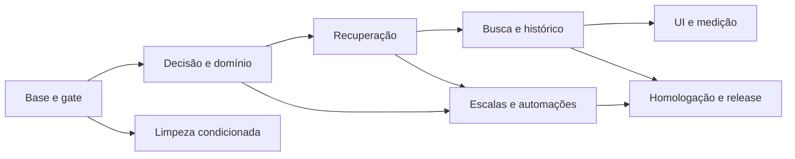

# Roadmap posterior de execução

Proposta para a Fase B, não executada. Base: 32 achados do SHA auditado.
Esforços são relativos, sem compromisso de prazo: pequeno = mudança localizada;
médio = camadas/estados relacionados; grande = ambiente e aceite operacional.
Não iniciar mudança remota, commit ou publicação com base neste documento.

## B0 — Base reproduzível e confiança no gate

Achados: QA-001 e REPO-001. Esforço pequeno/médio; risco baixo no produto.
Depende de autorização de implementação e preservação do trabalho local.

Corrigir a espera de navegação para decidir desktop/móvel somente após shell
disponível. Atualizar índice de estado atual com SHA e contagens verificadas;
manter relatórios datados. Entregar regressão que reproduz a intermitência
sem aceitar timeout como êxito. Saída: caso repetido estável e matriz E2E
inteira aprovada no novo SHA; docs sem baseline apresentado como atual por
engano.

## B1 — Decisão informada e processos essenciais

Achados: UX-001, DB-002, DB-001, UX-002. Esforço médio; risco alto no domínio.
Pode preparar reprodução junto de B0; depende de gates confiáveis para release.

Exibir proposta de escala e comparar versão/estado atual antes da decisão.
Corrigir seleção de lembretes com progresso demonstrável e exclusão de estados
terminais. Corrigir alias do cancelamento em migration nova e investigar o
recorte temporal hoje encoberto. Ajustar alvo/contrato da ciência automática
conforme decisão de produto, mantendo consentimento e política por paciente.

Saída: regressões desktop/móvel da proposta; prova 25 canceladas + 1 válida
com progresso; consumo histórico/atual e devolução preservados; ciência com
conteúdo apresentado segundo o contrato. Repetir clean/legacy/Auth/RLS após
SQL. Sem editar migrations históricas ou fabricar saldo para passar o teste.

## B2 — Recuperação de operações assíncronas

Achados: UX-003, UX-004, UX-007, UX-012, BE-005, DB-004. Esforço médio;
risco médio/alto por idempotência e ciclo de vida. Depende dos contratos de B1.

Definir tentativa imutável com estados de envio, persistência incerta e
reconciliação. Preservar chave/corpo na proposta global e no anexo; liberar
edição somente quando seguro. Tratar expiração/reserva de upload sem remover
objeto válido. Separar vazio, loading, erro e retry. Alinhar acompanhamento
ao prazo efetivo e declarar corretamente a duração do rascunho.

Saída: erro antes da persistência, resposta perdida depois dela, reload,
duplo clique, arquivo alterado, quota de reservas e falha de Storage exercidos;
mesma tentativa produz mesmo resultado, versão conflitante pede revisão.
Não criar abstração genérica sem consumidores concretos nesses fluxos.

## B3 — Trabalho encontrável e apresentação de mudanças

Achados: BE-001, BE-004, UX-005, UX-006, UX-009, DB-007. Esforço médio;
risco médio, principalmente filtros, links e invalidação.

Adicionar busca/paginação autorizada e deeplink efetivo para consumo e audit.
Apresentar diferenças de proposta e histórico por ação, autor, tempo e motivo;
padronizar vocabulário do glossário. Corrigir destinatários de invalidação de
perfil e proponente global sem conceder vínculo local implícito.

Saída: pendência além da posição 100 é localizável; filtros não vazam paciente;
URL antiga continua válida; versão e diff são legíveis; atualização chega ao
usuário correto, inclusive após mudança de perfil. Decidir o texto entre
“itens atendidos” e divergência de quantidade da ENT com usuários reais.

## B4 — Escalas e orçamento das automações

Achados: DB-003, DB-006, BE-002, BE-003. Esforço médio; risco alto se alterar
autoridade temporal, retries ou marcação de entrega. Depende de B1/B2.

Primeiro reproduzir encerramento de série proposta seguido de aprovação.
Só então corrigir o comportamento confirmado. Demonstrar avanço do scheduler
legado além de 100 pacientes. Produzir parâmetros de mensagem a partir do
evento correto. Medir timeout, upload, envio, concorrência e lease com falhas
realistas; escolher batch ou orçamento que respeite o limite do worker.

Saída: regressões temporais, multipaciente e de presenter; nenhum sucesso
externo presumido; estados incertos reconciliáveis; prova de orçamento no
limite configurado. BAL por plantão e rotação já existentes permanecem válidos.

## B5 — Consistência visual e desempenho medido

Achados: UX-008, BE-006, DB-005, BE-007. Esforço médio, condicionado à medição;
risco médio por snapshots e apresentação. Depende das jornadas estabilizadas.

Consolidar os padrões usados, preservando Fluent, acessibilidade e tokens;
não redesenhar todo o produto apenas por coexistência de CSS. Medir queries,
payload e histórico de documentos em volumes definidos. Só otimizar após
identificar custo/latência relevantes. Decidir estoque observado no PDF de
REQ e melhorar densidade de impressão sem alterar o significado documental.

Saída: comparação antes/depois, mesmo ledger/hash/versionamento, acessibilidade
dos estados afetados e aceite editorial. Não adicionar quantidade solicitada,
descartar história ou enfraquecer autorização para reduzir consultas.

## B6 — Operação, provedores e release

Achados: OPS-001, REPO-003, REPO-004. Esforço médio/grande; risco de ambiente
exige destino e autorização explícitos. Depende dos gates aplicáveis de B0–B4;
B5 não é bloqueador automático.

Separar inspeção e submissão Meta, paginar e exigir conta escolhida. Exportar
código para verificação Linux sem diretórios privados. Ensaiar recuperação
integral em destino autorizado. Homologar dispositivo, operadores e canais
externos escolhidos. Publicar somente após autorização correspondente, backup
correto e aceite; então smoke do SHA implantado e plano de retorno verificado.

Saída: matriz H01–H11 assinada pelos responsáveis adequados, evidências do
destino real, RPO/RTO, contingência e alertas. Flags externas desligadas se
esses canais não fizerem parte do escopo aprovado. Nunca reset remoto.

## B7 — Limpeza condicionada e documentação sustentável

Achados: UX-010, UX-011, REPO-002. Esforço pequeno/médio; risco baixo somente
após nova busca de consumidores. Pode seguir após correções essenciais.

Confirmar novamente ausência de uso dos três componentes candidatos; avaliar
URLs de assets públicos e compatibilidade. Parametrizar ou arquivar geradores
históricos sem sobrescrever evidência. Corrigir a interpretação da captura
BAL histórica no índice, mantendo o arquivo original e sua proveniência.

Saída: cada remoção com justificativa e busca registrada; testes preservados;
links persistidos funcionando; relatórios antigos intactos. Reorganização
física ampla requer benefício demonstrado e deve ficar em lote separado.

## Dependências e revisão de escopo

Cada lote deve trazer diff revisável, invariantes, reprodução anterior,
regressão posterior e atualização da matriz. Descoberta que muda causa ou
impacto atualiza o achado antes da implementação; não transformar hipótese
em correção especulativa. Reavaliar prontidão pelo escopo do release, sem
somar P3 para fabricar bloqueio nem ocultar P1 sob uma média de testes.
