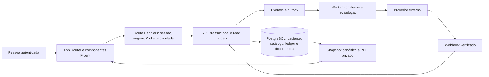

# Mapa do repositório e arquitetura

SHA auditado: `37cb7f85e96e551d6419871f94dd950712e2565b`, branch `master`.
Os 503 paths da base estão em `evidence/tracked-files.txt`; a matriz de
cobertura
reconcilia esse conjunto sem contar os próprios entregáveis como código
auditado.

## Componentes e autoridade

O paciente é a unidade operacional. Identidade global, vínculo por paciente e
contexto ativo são conceitos distintos. A seleção no navegador não concede
acesso. APIs verificam sessão, origem e contrato; RPCs reavaliam autoridade,
escopo, versão e invariantes sob transação. Grants, RLS, ownership e funções
SECURITY DEFINER são partes da mesma fronteira, não mecanismos intercambiáveis.

## Estrutura física

- Caminho: `src/app`; Responsabilidade: Páginas e endpoints App Router;
  Entradas/consumidores: Navegação, sessão e clientes HTTP
- Caminho: `proxy.ts`; Responsabilidade: Renovação de sessão e caminho de
  retorno; Entradas/consumidores: Requisições com matcher; não substitui guard
- Caminho: `src/components/layout` e `ui`; Responsabilidade: Shell, contexto,
  navegação e controles; Entradas/consumidores: Jornadas por papel e viewport
- Caminho: `src/components/requisitions`; Responsabilidade: REQ, revisão,
  ciência, recibo e histórico; Entradas/consumidores: Pessoa operacional,
  família e supervisão
- Caminho: `src/components/documents`; Responsabilidade: COM/ENT/BAL, detalhe,
  ações, anexos e impressão; Entradas/consumidores: Estado e versão persistidos
- Caminho: `src/components/schedules` e `stock`; Responsabilidade: Escalas,
  saldos, contagem e consumo; Entradas/consumidores: Vínculos, políticas,
  referências de ledger
- Caminho: `src/lib/server`; Responsabilidade: Guards, RPCs, catálogo, PDF e
  observabilidade; Entradas/consumidores: Route Handlers; segredos somente no
  servidor
- Caminho: `src/lib/notifications`; Responsabilidade: Registry, parâmetros,
  provider e worker; Entradas/consumidores: Outbox, callbacks e política de
  canal
- Caminho: `src/types` e `src/theme`; Responsabilidade: Contratos de leitura e
  fundação visual; Entradas/consumidores: Componentes e serviços
- Caminho: `supabase/migrations`; Responsabilidade: Evolução imutável de schema
  e funções; Entradas/consumidores: Instalação limpa e atualização
- Caminho: `scripts`; Responsabilidade: Guards, preparação, replay, geração e
  diagnósticos; Entradas/consumidores: Desenvolvimento, CI e operação explícita
- Caminho: `tests`; Responsabilidade: Unitários, API, SQL, HTTP/Auth e
  navegador; Entradas/consumidores: Contratos positivos, negativos e
  concorrência
- Caminho: `docs`; Responsabilidade: Contratos atuais, decisões e evidências
  datadas; Entradas/consumidores: Engenharia, homologação e operação

## Fatos de domínio e suas fronteiras

- Fato: Catálogo do paciente; Autoridade: `care_recipient_products`; Invariante
  e recuperação: `products` preserva identidade; unidade não reinterpreta
  histórico
- Fato: REQ; Autoridade: Banco, protocolo e snapshot; Invariante e recuperação:
  Intenção sem quantidade solicitada; retry conserva tentativa
- Fato: COM; Autoridade: Aprovação, aquisição, recebimento e validação;
  Invariante e recuperação: Crédito familiar depende da etapa autorizada, não do
  clique inicial
- Fato: ENT; Autoridade: Expedição, trânsito, destinatário e aceite; Invariante
  e recuperação: Quantidade positiva recebida atende item; diferença exige
  resolução
- Fato: BAL; Autoridade: Referência de saldo/revisão e contagem; Invariante e
  recuperação: Mudança do ledger invalida referência; política define revisão
- Fato: Escala; Autoridade: Plantão persistido e propostas; Invariante e
  recuperação: Sobreposição e alterações passam por autoridade; obrigações
  derivam do plantão real
- Fato: Consumo/ocorrência; Autoridade: Relato e revisão/confirmador; Invariante
  e recuperação: Relato/IA/Flow não debita automaticamente
- Fato: Documento/PDF; Autoridade: Versão e snapshot canônico; Invariante e
  recuperação: Hash de conteúdo e bytes têm funções distintas; hash não é
  assinatura digital
- Fato: Notificação; Autoridade: Evento, outbox e callback; Invariante e
  recuperação: Salvo, enviado, entregue, lido e aceito são estados diferentes

As rotas de documentos antigas e novas convergem para consumidores atuais.
Manter compatibilidade de links persistidos é parte do domínio, não mero custo
de organização. O modo BAL por plantão coexistente com o modo anterior é
política por paciente; não deve ser removido por simplificação visual.

## Dependências e oportunidades

As fundações corretas já existem: RPC transacional, contexto explícito,
catálogo por paciente, ledger e documentos versionados. A Fase B deve corrigir
as bordas entre esses blocos: apresentação da proposta antes da decisão,
recuperação de tentativas, localização de pendências antigas e consistência
dos parâmetros de mensagens. Uma nova camada genérica ou troca de stack não
tem benefício demonstrado nesta revisão.

Os detalhes de API e acoplamento estão em `ARCHITECTURE_AND_BACKEND.md`;
schema/ACL em `DATABASE_AUTH_SECURITY.md`; a travessia humana dessas fronteiras
em `JOURNEYS_AND_INFORMATION_ARCHITECTURE.md`. A matriz de cobertura registra
o método por arquivo, evitando inferir compreensão semântica a partir de
contagem de imports ou execução de testes.
