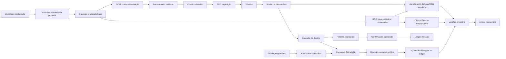

# Mapa canônico dos processos e estados

O [inventário](01_PROCESS_INVENTORY.csv) identifica 66 processos/subprocessos
em 12 famílias. Cada linha possui necessidade, atores, entrada, saída, efeitos,
exceções, recuperação, implementação e relatório próprio de aprofundamento.
A [cobertura](01_PROCESS_COVERAGE.csv) distingue reconstrução de execução;
enumerar um processo não significa homologar suas combinações.

## Relações entre processos

COM pode existir sem REQ; REQ pode ser atendida com material familiar já
disponível, sem nova COM. ENT pode existir sem vínculo REQ e então não atende
automaticamente a necessidade. Quantidade de REQ é observação física, sem
campo de quantidade pedida. Aviso, ciência, aceite e atendimento são fatos
independentes.

## Estados que não cabem em uma única coluna

- **Processo:** REQ; **Dimensões simultâneas:** status administrativo;
  atendimento por linha; ciência; prazo; arquivo; **Erro de interpretação a
  evitar:** Ciência ou compra não conclui atendimento

- **Processo:** COM; **Dimensões simultâneas:** aprovado; adquirido acumulado;
  receipts pendentes; aceito validado; **Erro de interpretação a evitar:**
  Aquisição não é estoque disponível

- **Processo:** ENT; **Dimensões simultâneas:** expedição; aceite; diferença;
  conciliação; cancelamento; **Erro de interpretação a evitar:** Confirmada pode
  ter linha conciliada como faltante

- **Processo:** Estoque; **Dimensões simultâneas:** custódia; saldo confirmado;
  trânsito; previsão; mínimo; **Erro de interpretação a evitar:** Trânsito e
  compra prevista não são saldo da equipe

- **Processo:** BAL; **Dimensões simultâneas:** obrigação; atribuição; janela;
  contagem; revisão; ajuste; **Erro de interpretação a evitar:** Semana contada
  e saldo aprovado exigem leituras distintas

- **Processo:** Escala; **Dimensões simultâneas:** série; ocorrência; proposta;
  corte; vínculo atual; **Erro de interpretação a evitar:** Publicação não é
  presença; proposta não altera ocorrência

- **Processo:** Pessoa; **Dimensões simultâneas:** Auth; perfil; email; convite;
  membership; contexto; capacidade; **Erro de interpretação a evitar:** Convite
  aceito não equivale a competência em todos processos

- **Processo:** Comunicação; **Dimensões simultâneas:** registro; interno;
  provedor; entrega; leitura; seen; ciência; **Erro de interpretação a evitar:**
  Falha de mensagem não desfaz documento persistido

## Sequência de investigação e segunda passada B2.1

A primeira passada partiu das necessidades, contratos API, tipos de leitura,
schemas e entradas de RPC. A segunda conferiu processos que uma lista de
páginas esconderia: adoção de catálogo, reemissão de convite, desativação com
saldo, regularização de semanas, passagem de responsabilidades, importação
física, conciliação de trânsito e recuperação de resultado incerto.

Contraprovas: não se propõe criar estoque inicial por COM artificial porque
movimento familiar avulso já existe; não se propõe um sistema de presença como
correção da agenda, cujo contrato é programação. Lote/validade e passagem
integrada constam como necessidades candidatas, sem presumir módulo novo.
Draft local e draft servidor são processos distintos; ambos foram localizados.

O catálogo de [transições](02_PROCESS_TRANSITIONS.csv) foi aprofundado em cada
subgrupo e reconciliado em 102 linhas. Transição `PROIBIDA` identifica o guard
esperado; `CONDICIONAL` exige
fato/autoridade adicional; `NAO_EXISTENTE` é uma lacuna de capacidade, sem
alegar erro de execução. A coluna de verificação impede confundir a leitura do
contrato com prova de persistência. A matriz de atores conserva a fronteira por
paciente/capacidade; decisões específicas são detalhadas nos relatórios.

89 transições têm amostras locais dirigidas e13somente reconstrução estática;
ambas trazem nota de alcance por ramo. Guard esperado e comportamento observado
podem divergir, como autoaprovaçãoBALlegada; isso está explícito no registro,
sem converter uma proibição desejada em controle implementado. Transições
novasT089–102 cobrem reabertura, recontagem, sucessão, retry e ciência tardia.
As dimensões de estado não são agregadas como se houvesse um único status.
