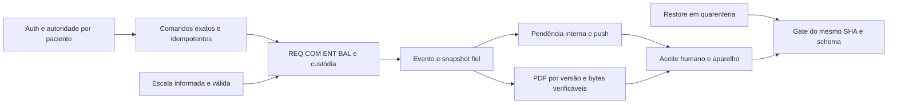

# C1 — reconciliação causal e prioridades

Os nove registros originais de B8 completam **165 registros brutos**:
A 32, B1 35, B2 17, B3 25, B4 13, B5 14, B6 13, B7 7 e B8 9.
O [crosswalk](FINDINGS_165_SOURCE_CROSSWALK.csv) preserva cada ID uma única
vez,
prioridade, natureza, confiança, método/fonte e contexto de evidência. A linha
`source_record` é ordinal lógico de registro CSV, não linha física do arquivo.
Nenhum ID novo substitui ou apaga o original.

O [registro causal](CAUSE_FAMILIES_MASTER.csv) contém **121 causas**. Ele
mantém
os contratos corretos e lacunas de prova. Causas incluem defeito, risco,
capacidade ausente, qualidade, decisão e homologação; não são 121 defeitos
independentes confirmados em produção. Natureza/confiança original permanecem
consultáveis no crosswalk. `SOURCE_METHOD_SCOPED` exige consultar esse método;
nunca significa que uma leitura estática virou teste executado.

## Adjudicações da consolidação

<!-- c-table:start -->

- **Entradas:** B8-R036 e R112

  **Decisão de C:** C-CAUSE-036 reúne B1-DOC-001, BE-007 e B6-013

  **Justificativa e regressão conservada:** Mesma projeção da tabela REQ omite
  estoque observado; B6 acrescenta situação por linha. Aceite conserva
  observação e atendimento por item, sem quantidade solicitada.

- **Entradas:** B8-Q001

  **Decisão de C:** Nova C-CAUSE-119

  **Justificativa e regressão conservada:** Insuficiência do teste PDF é
  independente da omissão do renderer. O teste em branco deve falhar mesmo
  após corrigir a tabela.

- **Entradas:** B8-Q002

  **Decisão de C:** Nova C-CAUSE-120

  **Justificativa e regressão conservada:** Predicado SQL aceita NULL; não se
  funde com arredondamento ou autorização do produto.

- **Entradas:** B8-Q003

  **Decisão de C:** Nova C-CAUSE-121

  **Justificativa e regressão conservada:** Perda de resultado inconclusivo da
  CI é distinta de foco, reflow ou PDF sem tags. Incomplete não vira violação
  automática.

- **Entradas:** B8-Q004

  **Decisão de C:** C-CAUSE-040 existente

  **Justificativa e regressão conservada:** Readiness transitória do mesmo
  helper QA-001/B1-QA-001; não cria nova causa.

- **Entradas:** B8-M001/M002/M003/M004/M005

  **Decisão de C:** C-CAUSE-002/006/003/004/007

  **Justificativa e regressão conservada:** Revalidações de estado documental,
  destino de ferramenta, inspect/submit, cópia Linux e candidatos de limpeza.
  Relações secundárias não fundem causas.

- **Entradas:** B8-R061 e R095

  **Decisão de C:** Permanecem C-CAUSE-061 e 095

  **Justificativa e regressão conservada:** Produtor não incrementa revisão e
  consumidor não refaz consulta são correções complementares; uma não cura a
  outra.

- **Entradas:** B8-R066 e R074

  **Decisão de C:** Permanecem C-CAUSE-066 e 074

  **Justificativa e regressão conservada:** RPC perde precisão antes de
  validar; API number aceita representação que string recusa. Ambas as
  fronteiras exigem testes próprios.

- **Entradas:** Anexo com resposta perdida e reserva abandonada

  **Decisão de C:** C-CAUSE-017 e 052 distintas

  **Justificativa e regressão conservada:** Editabilidade incerta no cliente
  não equivale a ausência de abandono/expiração no servidor.

- **Entradas:** BAL legado e BAL agendado

  **Decisão de C:** C-CAUSE-054 preserva recorte

  **Justificativa e regressão conservada:** Guard correto do agendado não
  prova revisão independente do legado. Sem substituir evidência forte pela
  descrição do bug.

- **Entradas:** Entrega e transferência bilateral

  **Decisão de C:** Decisão P07, não fusão de fatos

  **Justificativa e regressão conservada:** Contrassinatura da contraparte não
  é aceite físico por outro recebedor.

<!-- c-table:end -->

Resultado aritmético após revisão: 119 famílias B8, menos uma sobreposição,
mais três causas novas de qualidade; seis revalidações B8 apenas se vinculam.
Os outros recortes mantêm distinções de fronteira, fato, efeito e recuperação.
Não se usa semelhança de palavra, componente ou lote D como prova de causa
comum.

## Dois bloqueadores prioritários

- **C-CAUSE-009:** UX-001/B1-UX-001, decisão informada de escala. Exibir
pessoa, datas, horário, fuso, versão, antes/depois e efeito BAL; comparar
resumo e estado efetivamente aplicado. Nenhuma aprovação em GET.
- **C-CAUSE-049:** DB-002/B3-001, seleção REQ sem progresso. Registros
  terminais
não podem ocupar indefinidamente o lote. Provar alcance finito com 25/100
bloqueadores e múltiplos alvos, deduplicação e falha intermediária.

São duas causas P1, não quatro incidentes. Texto, PWA ou reorganização não as
resolvem. Não houve correção de produto nesta fase.

## Severidade versus gate do primeiro uso

92 causas inicialmente exigem tratamento para o escopo central, 19 dependem
da ativação do canal/regime, oito podem aguardar, uma exige homologação de
recuperação e uma depende da política de URL. A classificação de gate é uma
proposta técnica de C para o escopo aprovado; não promove todos os P3 a P1.
Inclui a deriva documental tratável em C6, que terá resultado próprio.
Nenhuma correção é presumida por estar planejada.

WhatsApp e Flows podem aguardar conforme DEC-019; consumidor de consumo/fila
administrativa em C-CAUSE-095 continua central. O legado de lembretes só sai
do gate se a desativação e a cobertura por alternativa forem demonstradas.
PDFs com corte ou perda de anotação (B6-007/008) bloqueiam os caminhos
afetados.
A acessibilidade pode exigir alternativa completa autorizada e validada;
uma declaração de suporte ou axe verde não basta.

## Dependências e limites

Restauração, provedores, credenciais profissionais verificadas, aparelhos,
impressão, AT, volume/SLO e último deploy permanecem não homologados nesta C.
As matrizes não convertem mocks em testes reais. Provas anteriores permanecem
datadas e consultáveis; não foram reexecutadas para atualizar contagens.

Critérios e camada de prova por causa estão em
[aceites e regressão](../C6-acceptance-handoff/ACCEPTANCE_CRITERIA_MASTER.csv).
O [impacto](../C4-technical-design/CHANGE_IMPACT_MATRIX.csv) é plano de
alteração,
não patch ou migration. Cada ID liga origem → causa → decisão → especificação
→ lote → verificação, inclusive riscos e itens adiados.
