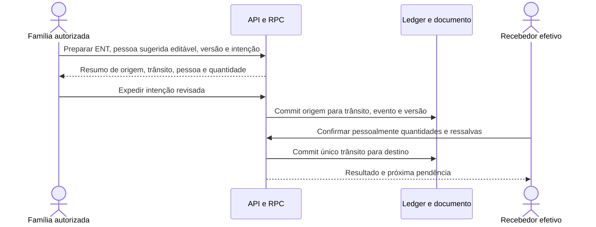
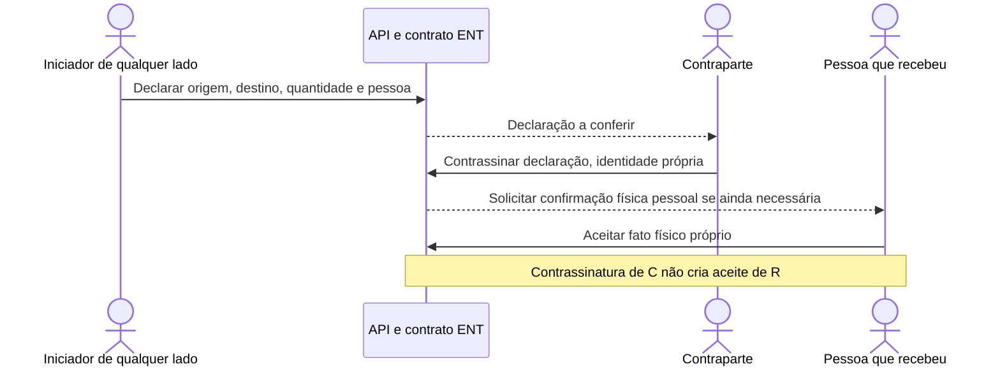
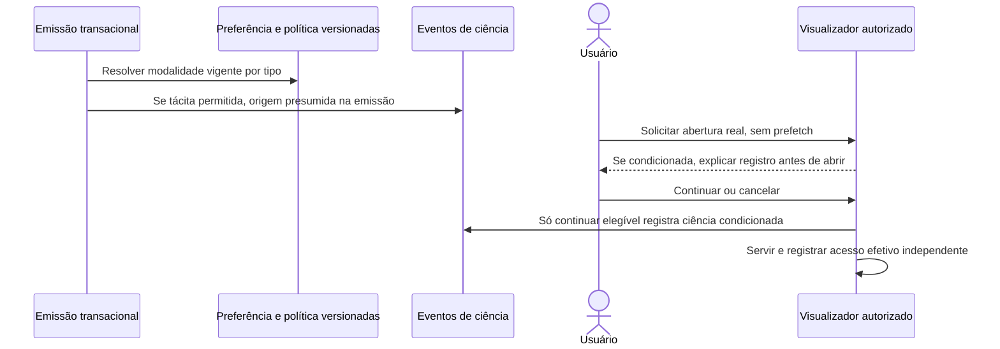
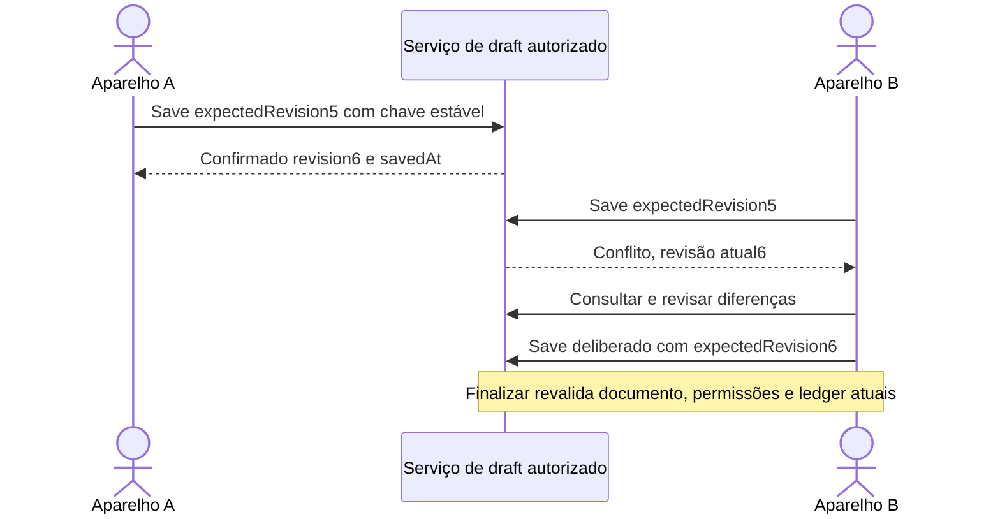
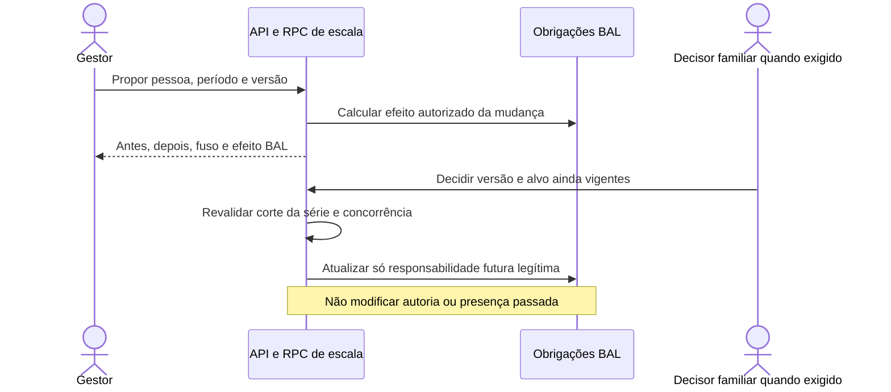
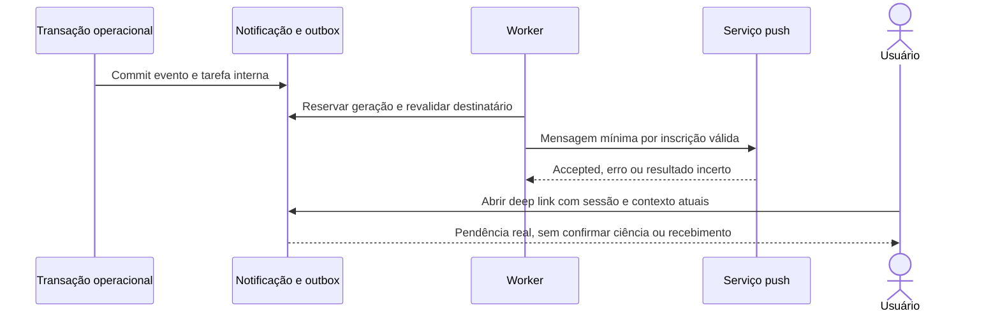

# Falhas, recuperação e sequências de referência

As sequências modelam TO_BE, sem chamadas executadas em C. Setas de
persistência
representam transação/RPC autorizada, não DML do browser. A fonte do fato é
preservada quando outra etapa falha.

## Matriz de interrupção

<!-- c-table:start -->

- **Ponto de falha:** Antes de validar/commit comprovadamente recusado

  **Resultado que pode ser afirmado:** Sem efeito, código seguro de
  campo/estado/autoridade

  **Continuação segura:** Corrigir a intenção; nova chave só se nova intenção.

- **Ponto de falha:** Resposta perdida durante commit

  **Resultado que pode ser afirmado:** Resultado incerto

  **Continuação segura:** Consultar mesma chave e hash; não editar conteúdo ou
  duplicar.

- **Ponto de falha:** Edição salva, emissão recusada

  **Resultado que pode ser afirmado:** Etapa 1 confirmada, etapa 2 recusada

  **Continuação segura:** Mostrar versão salva e saldo/ação da segunda;
  retomar sem repetir evento 1.

- **Ponto de falha:** Objeto enviado, vínculo falhou

  **Resultado que pode ser afirmado:** Arquivo pode existir sem ready/ponteiro

  **Continuação segura:** Consultar reserva/tentativa; conciliar e não criar
  objeto novo por padrão.

- **Ponto de falha:** Ready registrado, resposta perdida

  **Resultado que pode ser afirmado:** Arquivo confirmado recuperável

  **Continuação segura:** GET autorizado identifica mesmo arquivo/hash;
  bloquear troca sob chave antiga.

- **Ponto de falha:** Upload de mídia falhou antes de messages

  **Resultado que pode ser afirmado:** Mensagem ainda não iniciada

  **Continuação segura:** Classificar etapa e retry seguro, sem falsa
  conciliação de entrega.

- **Ponto de falha:** Messages/push em voo sem resposta

  **Resultado que pode ser afirmado:** Aceitação externa incerta

  **Continuação segura:** Estado por tentativa e conciliação; não prometer
  exatamente uma entrega.

- **Ponto de falha:** Callback antigo durante lease nova

  **Resultado que pode ser afirmado:** Resultado da geração antiga

  **Continuação segura:** Atualizar tentativa correspondente; não encerrar
  worker atual.

- **Ponto de falha:** Broadcast perdido ou consumidor stale

  **Resultado que pode ser afirmado:** Fato persiste; tela pode estar antiga

  **Continuação segura:** Revisão/reconexão/poll dirigido refaz consulta, sem
  apagar edição.

- **Ponto de falha:** Restore com jobs antigos

  **Resultado que pode ser afirmado:** Estado após corte potencialmente
  incoerente com mundo externo

  **Continuação segura:** Quarentena antes de egress/cron, conciliar e liberar
  explicitamente.

<!-- c-table:end -->

## ENT e pessoa recebedora



## Transferência simples, ramo P07-A proposto



## Consumo textual e complemento

```mermaid
sequenceDiagram
  actor R as Relator
  participant A as API e RPC
  actor V as Confirmador autorizado
  participant L as Relato e ledger
  R->>A: Texto livre, intenção e custódia
  A->>L: Relato sem débito
  R->>A: Complemento versionado com material e quantidade
  A->>L: Novo esclarecimento, original preservado
  V->>A: Confirmar versão explícita
  A->>L: Um débito e evento autoral
  A-->>V: Mesma decisão recupera; oposta conflita
```

## Ciência e abertura



## Draft em dois aparelhos



## Escala com efeito BAL



## Aviso interno e push



Oráculos de recuperação conferem chave, conteúdo, ator, versão e efeito
persistido. Não repetir o probe antigo só para obter data nova; implementar
regressão com comportamento correto. Gate completo ocorre no candidato de
release, enquanto alteração apenas documental recebe validação de integridade.
